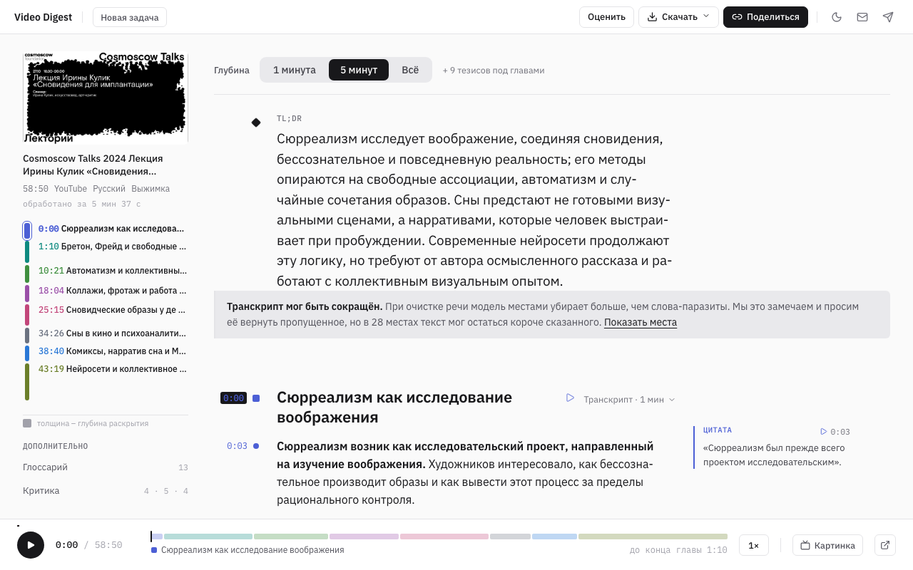
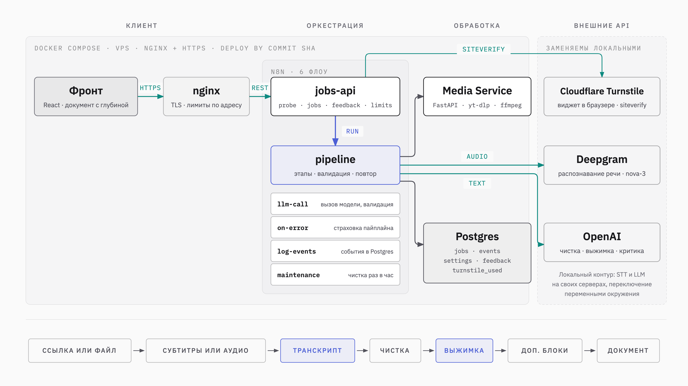

# Video Digest

Ссылка или файл с видео → очищенный транскрипт и выжимка с тезисами, привязанными к секундам записи.
Работающий экземпляр: https://digest.inforobot.space
[](https://github.com/inforobotvit/video-digest/actions/workflows/ci.yml)



## Что это

Вставляете ссылку на YouTube, VK Видео, Rutube, прямую ссылку на медиафайл или загружаете файл – получаете один документ: TL;DR, структуру, тезисы и цитаты с таймкодами, очищенный транскрипт и блоки по пресету (глоссарий, критика аргументации, самопроверка, решения, задачи, открытые вопросы). Документ читается с регулятором глубины – от TL;DR до транскрипта, рядом плеер, клик по таймкоду перематывает запись. Экспорт – md, srt, html, pdf и zip со всем сразу.

Качество проверяет код, а не модель: каждый ответ модели сверяется со схемой и правилами, таймкод тезиса берётся из транскрипта, цитата, которой нет в транскрипте дословно, выбрасывается, потери при чистке транскрипта измеряются и показываются читателю оговоркой.

## Как устроено

1. Фронт (React + Vite + TS) – статика за nginx, ходит только в `/api/`. Внутренний nginx держит лимиты по адресу и не пишет журнал запросов.
2. Cloudflare Turnstile – проверка браузера на форме запуска: виджет в браузере, токен уходит с задачей, `jobs-api` проверяет его у Cloudflare и сам ловит повтор. Режимы `off` / `monitor` / `enforce` – строкой в таблице `settings`, без перезапуска. Необязателен: без него сервис работает в режиме `off`.
3. n8n – шесть флоу: `jobs-api` (публичные вебхуки: probe, jobs, статус, retry, export, media, feedback, limits), `pipeline` (этапы обработки, статусы и результат в Postgres), `llm-call` (один вызов модели с валидацией ответа и одной попыткой исправления), `log-events` (нефатальные события в таблицу `events`), `on-error` (страховка пайплайна: исключение в ноде закрывает задачу за секунды, а не по таймауту), `maintenance` (раз в час: удаление результатов старше срока хранения, закрытие зависших задач).
4. Media Service (FastAPI) – yt-dlp с JS-рантаймом Deno, ffmpeg, субтитры, нарезка аудио по тишине, артефакты и их чистка. Внутренний, за `X-API-Key`.
5. STT – на эталонном экземпляре Deepgram nova-3. Провайдер переключается одной переменной (`STT_PROVIDER`: deepgram, openai, groq или любой OpenAI-совместимый сервер через `STT_BASE_URL`).
6. LLM – на эталонном экземпляре gpt-4o-mini на чистке транскрипта и map, gpt-5.6-luna на reduce и критике; любой OpenAI-совместимый сервер подключается через `LLM_BASE_URL`. Каждый ответ проверяется по схеме и правилам.
7. Postgres – пять таблиц: `jobs` (задачи, статусы, результат), `events` (события обработки, 7 дней), `settings` (лимиты, которые крутятся без перезапуска), `feedback` (оценки со страницы результата), `turnstile_used` (хэши проверенных токенов на десять минут).



Тёмный вариант схемы – `docs/design/architecture-dark.png`. Подробнее: `docs/architecture.md`, `docs/contract-api.md`, `docs/result-schema.md`.

## Лимиты

- Видео до 90 минут (`MAX_DURATION_SEC`), файл до 200 МБ (`UPLOAD_MAX_MB`); обе цифры страница берёт с сервера через `GET /api/limits`, не из своих строк.
- Дневной бюджет на провайдеров в долларах (`DAILY_BUDGET_USD`, скользящие 24 часа) и очередь из `MAX_CONCURRENT_JOBS` задач одновременно: при исчерпании – `429 daily_limit` или `429 busy`, задача не создаётся. Значения живут в таблице `settings` и меняются одной строкой SQL; переменные окружения – запасные.
- Лимиты по адресу в nginx: создание задач 2 в минуту, probe 10 в минуту, опрос статуса 2 в секунду, экспорт 6 в минуту; отказ – `429 rate_limited` с JSON-телом, в журнал не пишется.

## Запуск локально

Нужны Docker с Compose, Node 24 и ключи STT и LLM.

```bash
cp infra/.env.example infra/.env        # заполнить: API_KEY и MEDIA_API_KEY (одно значение), POSTGRES_PASSWORD,
                                        # STT_* или DEEPGRAM_API_KEY, LLM_API_KEY; TURNSTILE_MODE=off
(cd frontend && npm ci && npm run build) # nginx отдаёт frontend/dist
docker compose -f infra/docker-compose.yml up -d --build
# http://localhost:5678 – создать владельца n8n, Settings → n8n API → ключ в N8N_API_KEY в infra/.env
n8n/scripts/credentials.sh && n8n/scripts/import.sh   # учётки и шесть флоу в локальный n8n
curl -s http://localhost/health
```

Сервис открывается на http://localhost. Только фронт, без бэкенда: `cd frontend && npm ci && npm run dev` – страницы собираются на фикстурах из `n8n/fixtures/`. Детали по частям: `media-service/README.md`, `frontend/CLAUDE.md`, `n8n/CLAUDE.md`.

Свой экземпляр на сервере – `docs/self-hosting.md`: переменные, первый запуск, Turnstile, бюджет, хранение, обратный прокси, обновление и откат. Встраивание в чужую систему через API и свои модели – `docs/integration.md`.

## Данные

Аудио уходит в Deepgram, текст – в OpenAI, браузер обращается к Cloudflare Turnstile. Результат хранится 30 дней, события и внутренние журналы – 7, загруженный файл удаляется сразу после извлечения аудио; IP-адреса не хранятся, cookies и аналитики нет. Полностью – на странице [/policy](https://digest.inforobot.space/policy) и в `docs/privacy-policy.md`; каждое утверждение там сверено с кодом. Под полем загрузки стоит строка о том, что файл уйдёт облачным ИИ-сервисам и что записи с конфиденциальной информацией и персональными данными загружать не стоит.

Это описание эталонного экземпляра. У своего экземпляра провайдеры, сроки и текст политики – ваши (раздел «Свой экземпляр»).

## Свой экземпляр

Текст страницы `/policy`, контакты автора в шапке и подвале и визитка `/about/` относятся к эталонному экземпляру digest.inforobot.space. При развёртывании у себя их заменяют:

| Что | Где |
|---|---|
| Имя, почта и Telegram в шапке, подвале и на `/policy` | `frontend/src/lib/contacts.ts` |
| Текст политики: провайдеры, ссылки на их условия, сроки хранения | `frontend/src/pages/ServicePages.tsx` (`PolicyPage`) и его источник `docs/privacy-policy.md` |
| Дата политики и строка под полем загрузки | `frontend/src/strings.ts` (`policyMeta`, `uploadNote`) |
| Визитка с QR на эталонный домен | `frontend/public/about/` – заменить или удалить |
| Домен для проверки Turnstile и ссылки в письмах | `TURNSTILE_HOSTNAMES`, `PUBLIC_URL` в `.env` |
| Пример конфига внешнего nginx | `infra/deploy/nginx-site.conf` (`server_name`) |

Если меняются провайдеры или сроки хранения, текст политики меняется вместе с ними: страница не должна обещать того, чего нет в конфигурации.

## Что отличает

- Один документ с регулятором глубины: от TL;DR до транскрипта, а не вкладки «выжимка / транскрипт».
- Пресеты под тип контента как набор умолчаний, любой блок можно добавить или снять; блок критики аргументации.
- Российские платформы и файлы: VK Видео, Rutube, загрузка видео и аудио.
- Контроль качества программно: таймкод тезиса привязывается к транскрипту, а не берётся у модели; цитата, которой нет в транскрипте дословно, выбрасывается; потери при чистке измеряются и показываются читателю оговоркой.
- Локальный контур: STT и LLM переключаются на self-hosted переменными окружения, весь сервис – один compose.

Обзор аналогов – `docs/competitors.md`.

## Структура репозитория

- `docs/` – источник правды: архитектура, контракт API, схема результата, ТЗ медиа-сервиса, бриф интерфейса, политика данных, развёртывание и интеграция, полевой журнал.
- `schemas/` – JSON Schema результата, из неё генерируются типы фронта.
- `media-service/` – FastAPI: probe, download, split, артефакты. Тесты, ruff, uv.
- `n8n/` – экспорт шести флоу, их генератор, промпты LLM-этапов, скрипты синхронизации с инстансом, реальные фикстуры.
- `frontend/` – React-клиент: главная с аккордеоном пресетов, ожидание, страница результата с плеером, опросом и экспортом, e2e на Playwright.
- `infra/` – docker-compose, nginx, SQL (пять таблиц), скрипты выката по SHA коммита.
- `.github/workflows/` – CI и сборка образа медиа-сервиса на теге.

## Цифры

Из `meta` результата: две живые задачи на эталонном экземпляре, лекция – прогон 13 октября 2026. STT – Deepgram nova-3, LLM – gpt-4o-mini на чистке и map, gpt-5.6-luna на reduce и критике.

| Видео | Длительность | Субтитры | Обработка | Стоимость |
|---|---|---|---|---|
| Cosmoscow, лекция Ирины Кулик | 59 мин | нет | 5 мин 37 с | $0.29, из них STT $0.25 |
| Загруженная запись с голосом | 1 мин 24 с | нет | 31 с | $0.009 |

## Что дальше

- Дубли в субтитрах VK: реплики приходят парами с повтором, чистка получает втрое больше слов.
- Потери при чистке транскрипта: размер куска, промпт, возможно другая модель; измеритель уже честный, причина не починена.
- Повтор задачи от сохранённого транскрипта, без новой транскрибации.
- Повторная ссылка – готовый результат вместо второй обработки того же видео.
- Чистка аудио у упавшей задачи сразу, а не через 48 часов.
- Прогон `import.sh` в CI на Linux против n8n той же версии, что в compose.

## Лицензии

- Код репозитория – MIT, `LICENSE`.
- Шрифты IBM Plex в `frontend/public/fonts/` и `frontend/public/about/fonts/` – SIL Open Font License 1.1, текст рядом со шрифтами (`OFL.txt`).
- n8n (образ `n8nio/n8n`, в репозитории его кода нет – только наши флоу) – под Sustainable Use License: она ограничивает коммерческое использование, и это проверяют при внедрении.
- ffmpeg в образе медиа-сервиса ставится из Debian, собран под GPL; сервис вызывает его как отдельный бинарник и не линкуется с ним.
- Остальные зависимости (npm, Python, базовые образы, yt-dlp, Deno, Gotenberg, Postgres) – под лицензиями, совместимыми с MIT.

## Как делалось

Продакт и арт-директор – один человек; Claude – архитектор и редактор, Claude Code – разработка, Claude Design – дизайн.
Документы в `docs/` – источник правды: контракт, схема, ТЗ и бриф читаются инструментами как договор, шаги маленькие, каждый с приёмкой и коммитом. Второе правило появилось по дороге: документ – источник правды, но каждое его утверждение сверяется с кодом и с сервером, потому что девять раз намерение было записано как факт – восемь раз в документах и один раз в отчёте. Эксперименты с цифрами, тупики и то, что оказалось неправдой, – `docs/field-notes.md`; вопросы и ответы о продукте и процессе – `docs/faq.md`.
